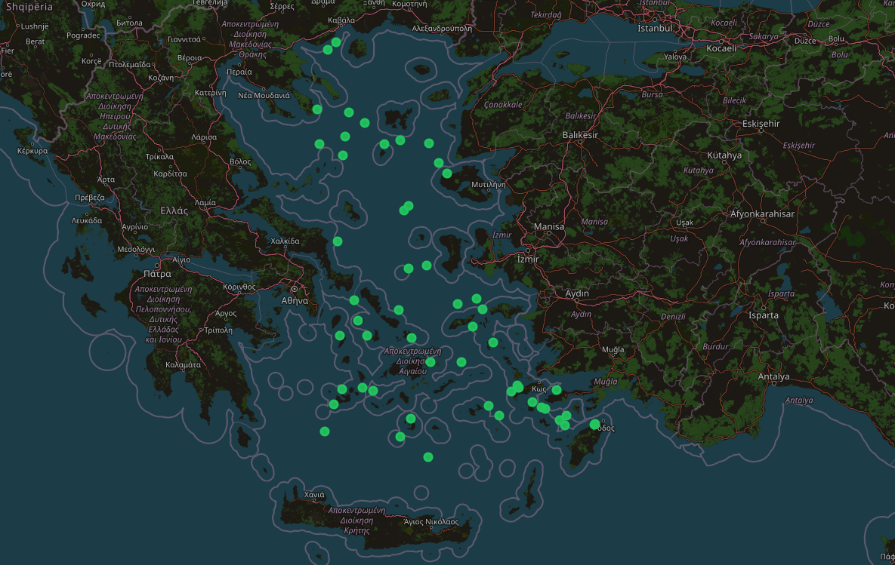
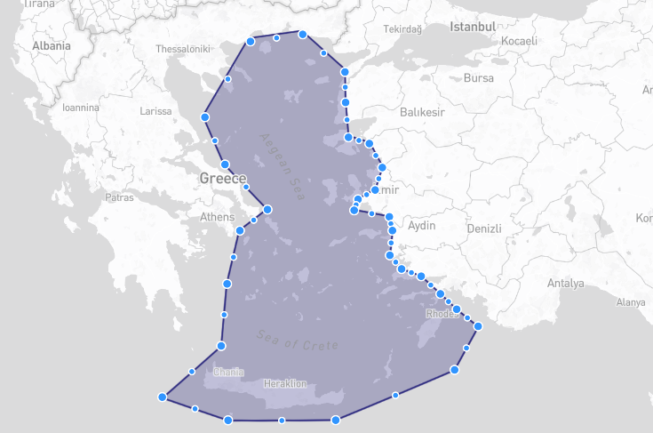
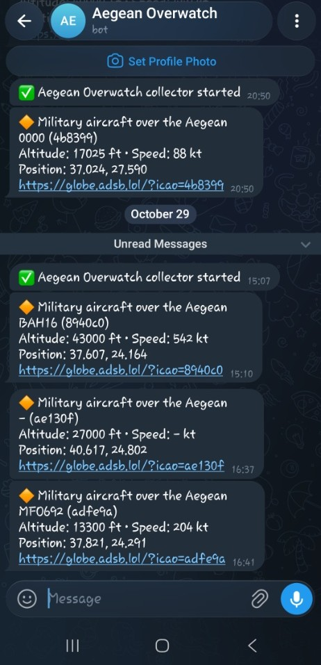

# Aegean Overwatch

**Open-source OSINT / GEOINT tool for ADS-B air traffic analysis over the Aegean Sea.**
A project by **STAMX Tech**.

> ⚠️ **Status: early development.** The project currently fetches live ADS-B data and geofences it to the Aegean. Analysis features (anomaly detection, GNSS interference mapping, map UI) are on the roadmap below.

---

## What it does (so far)

- **Live ADS-B ingestion** — queries the public [adsb.lol](https://adsb.lol) API for aircraft within a 250 NM radius of the central Aegean.
- **Data cleaning** — skips aircraft without a known position, normalizes callsigns, and handles missing fields safely.
- **Geofencing** — uses a custom Aegean polygon (GeoJSON) and a point-in-polygon test (via [Shapely](https://shapely.readthedocs.io/)) to keep only aircraft actually over the Aegean, discarding traffic over the surrounding mainland.
- **Summary output** — prints each aircraft (ICAO address, callsign, barometric altitude, position) and a summary line:

```
4bccaa  SXS8BF     39000  39.719, 25.396
4bb874  PGT4HT     35000  39.601, 25.571
Aircraft found: 98 | with position: 98 | inside Aegean: 18
```

## How it works

1. The API returns every aircraft inside a **circle** around a center point — a cheap, coarse filter.
2. That circle also covers large parts of the surrounding mainland, so each aircraft position is tested against a hand-drawn **Aegean polygon**.
3. Only aircraft inside the polygon are kept. In typical runs, most of the aircraft returned by the API are discarded at this step.

> Note: GeoJSON and Shapely use **`(longitude, latitude)`** order — the opposite of most map apps.

## Project structure

```
aegean-overwatch/
├── backend/
│   ├── data/
│   │   └── aegean.geojson      # Aegean geofence polygon
│   ├── ingest/
│   │   ├── fetch.py            # Fetch, clean and geofence aircraft
│   │   └── test_polygon.py     # Sanity test for the polygon (known inside/outside points)
│   └── requirements.txt
├── frontend/                   # (planned) map UI
├── docs/
├── LICENSE
└── README.md
```

## Getting started

**Requirements:** Python 3.10+

```bash
git clone https://github.com/MarStamSudo/aegean-overwatch.git
cd aegean-overwatch/backend

python -m venv .venv
# Windows
.venv\Scripts\activate
# Linux / macOS
source .venv/bin/activate

python -m pip install -r requirements.txt
```

Run from the repository root:

```bash
python backend/ingest/fetch.py          # fetch and geofence live aircraft
python backend/ingest/test_polygon.py   # verify the polygon (Naxos inside, Izmir outside)
```


## Roadmap

- [x] Live ADS-B ingestion from a public API
- [x] Aegean geofencing with point-in-polygon
- [x] Continuous polling and storage of track history (PostgreSQL + PostGIS)
- [x] Interactive map (React + MapLibre)
- [x] Multi-source data fusion (adsb.lol, airplanes.live, adsb.fi)
- [x] SQLite storage, read API (FastAPI) and live map (React + Leaflet)
- [x] Behavioral anomaly detection — loitering / orbit patterns, emergency squawks (7500/7600/7700), military-registered aircraft
- [x] Alerts
- [ ] GNSS interference mapping from ADS-B navigation integrity fields (NIC / NACp)


## Limitations

- Only aircraft that **broadcast ADS-B** are visible. Many military aircraft and UAVs do not, so the tool sees only the cooperative part of the airspace.
- Coverage depends on community ground receivers and may have gaps over open sea.
- The Aegean polygon is hand-drawn and approximate; it is not an official airspace or FIR boundary.
- "Unusual" does not mean "threat" — e.g. firefighting or survey aircraft can look like loitering.

## Ethics & responsible use

- Uses **publicly broadcast, publicly available** data only.
- Tracks aircraft, not people. No collection of personal data.
- Neutral, technical terminology; the tool makes no political or legal claims about airspace.
- Any public deployment will apply delays or filtering to military aircraft data.

## Data sources & attribution

- Aircraft data provided by **[adsb.lol](https://adsb.lol)**, made available under the **[Open Database License (ODbL)](https://opendatacommons.org/licenses/odbl/)**.
- Aircraft data provided by **[airplanes.live](https://airplanes.live)** (non-commercial use).
- Aircraft data provided by **[adsb.fi](https://adsb.fi)** (non-commercial use).

## License

Code is released under the [MIT License](LICENSE).

---

*Built by [STAMX Tech](https://github.com/MarStamSudo).*





Aircraft are kept only if their position falls inside this polygon (`backend/data/aegean.geojson`).
It covers the Aegean Sea and its islands, including Crete, and excludes the surrounding mainland.
The polygon is hand-drawn and approximate: it is a technical filter for this project,
**not** an official airspace, FIR or territorial boundary.



Automated Telegram alerts sent in real time whenever target activity is detected inside the geofenced boundary.